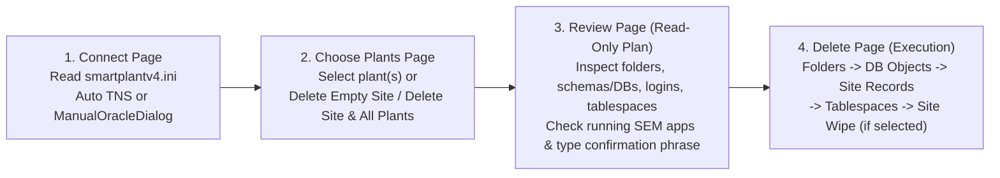

# Complete Handover Document — Delete Plant Utility v5.0

> [!IMPORTANT]
> **Internal Use Only.** This utility is an internal administration tool for Hexagon **Smart Engineering Manager (SEM)** sites. It permanently deletes plants, projects, file-system folders, Oracle schemas/tablespaces, SQL Server databases/logins, site metadata records, and optionally entire sites.

- **Version:** `5.0.0`
- **Last Updated:** `2026-10-19`
- **GitHub Repository:** `https://github.com/aravindpeddinti/Delete-Plant-Utility` (Branch: `feature/v5-development`)
- **Standalone Executable:** `Delete Plant Utility.exe` (built via `build_exe.bat`)

---

## 1. Whole Intent & Purpose of the Application

### 1.1 Background: What a Smart Engineering Manager (SEM) Site Creates
When an administrator creates a **Site**, creates **Plants** and **Projects**, or restores a plant into a site using Smart Engineering Manager, data is spread across three tightly coupled layers:

1. **Site Catalog & Metadata Layer (Primary Site Database/Schema)**
   - Configured by `smartplantv4.ini` (contains `[SITESCHEMA]` and `[DICTIONARY]` sections with encrypted credentials).
   - Stores the hierarchy of plants and projects (`T_RootItem`), database connection mappings for every plant/project schema (`T_DB_Data`), security roles and permissions (`T_Roles`, `T_RoleUsers`, `T_RoleRights`), and site-wide folder paths (`T_SiteSetting`).
2. **Plant & Application Database Layer (Primary or Secondary DB Servers/Instances)**
   - **Oracle Sites:** Each plant and project owns multiple Oracle schemas (`<PLANT>`, `<PLANT>_D`, `<PLANT>_PID`, `<PLANT>_PID_D`, `<PLANT>_SEL`, `<PLANT>_SELD`, project schemas `<PLANT>P1`, etc.) along with permanent and temporary tablespaces (`DBA_SEGMENTS`, `DBA_USERS`).
   - **SQL Server Sites:** Each plant and project owns SQL Server databases and server-level logins (`sys.databases`, `sys.server_principals`).
   - **Distributed / Cross-Server Topology:** A site can be hosted on **Oracle DB1** (or **SQL Server Instance1**), while individual plants are restored onto **Oracle DB2, DB3, ...** (or **SQL Server Instance2, Instance3, ...**).
3. **File System Layer (Local or UNC Network Shares)**
   - Plant and Project root directories (`T_RootItem.Path`).
   - Application Reference Data directories (P&ID and Smart Electrical reference folders stored in `<app_schema>.T_OptionSetting` for option IDs `Symbols`, `Report Files`, `Template Files`, `Import Map Files`, `SmartPlant Resources`, etc.).
   - Site-level folders (`Backup Location` and `Role Template Location` stored in `<site_schema>.T_SiteSetting`) and the `smartplantv4.ini` file itself.

### 1.2 Core Intent of Delete Plant Utility v5.0
Manually removing a plant or a site across all three layers is error-prone: leaving behind orphaned rows in `T_RootItem`/`T_DB_Data` corrupts the site catalog in SEM, while dropping a database before reading its `T_OptionSetting` table makes it impossible to discover and clean up its reference-data folders.

**Delete Plant Utility v5.0** replaces the legacy v4 console script (`legacy_versions/Delete Plant Utility v4.py`) with a **safe, auditable Windows application**. It provides a PyQt5 GUI and a headless Python API/JSON CLI for integrations, designed around the core requirements below:

1. **Read-Only Plan & Review Before Deletion:**
   - Connects to `smartplantv4.ini`, discovers all plants and projects, and builds a **100% read-only `DeletionPlan`** before changing anything.
   - The GUI displays every folder, schema/database, login, tablespace, and site record in an interactive tree where individual items can be unticked. Both interfaces enforce safety blocks for protected/shared resources and unsafe paths. Headless execution additionally requires an exact confirmation phrase, explicit acknowledgement, and a fresh process check that fails closed if process enumeration is unavailable.
2. **Resilience to Missing / Already-Dropped Schemas or Databases (Requirement 1):**
   - If a plant's schema (Oracle) or database (SQL Server) was already manually deleted or is missing on the target server, the utility does **not** fail or abort. It logs an informational note (`"Schema/Database <name> is not available on <server>. Proceeding to delete physical files and site info."`) and continues to remove the physical plant folders and clean up the site tables (`T_RootItem`, `T_DB_Data`, `T_Roles`, `T_RoleUsers`, `T_RoleRights`).
3. **Multi-Database & Multi-Instance Routing for Oracle and SQL Server (Requirements 1, 2 & 3):**
   - Inspects `DBSERVER`, `SYSUID`, and `SYSPASSWORD` per row in `T_DB_Data`.
   - When a site lives on **Oracle DB1** (or **SQL Instance1**) and plants live on **Oracle DB2..DBn** (or **SQL Instance2..Instancen**), the backend opens and caches dedicated secondary connections (`self.remote[server_key]`) to each remote database/instance, drops the schemas/tablespaces or databases/logins on the secondary server(s), and then deletes the site catalog records from the primary site server.
4. **Oracle TNS Auto-Discovery & Manual Connection Fallback Dialog:**
   - Automatically searches `TNS_ADMIN` and both 64-bit (`HKLM\SOFTWARE\ORACLE`) and 32-bit (`HKLM\SOFTWARE\WOW6432Node\ORACLE`) Windows Registry keys for `tnsnames.ora`.
   - If `tnsnames.ora` is missing or does not contain the site's Oracle alias, raises `ManualConnectionRequired` and opens `ManualOracleDialog`, pre-filling **Service Name**, **Username**, and masked **Password** (read-only from the INI) and **Port** (`1521` default, editable), while prompting the operator for the **Host Name** (editable).
5. **Automated Host Ping & Remote Service Port Diagnostics:**
   - Whenever any primary or secondary connection fails (Oracle or SQL Server, automatic or manual), `diagnose_connection_failure()` in `app/core/network.py` automatically:
     1. Extracts the hostname (`MACHINE\INSTANCE` $\rightarrow$ `MACHINE`, `host:port/service` $\rightarrow$ `host`).
     2. Pings the machine (`ping -n 1 -w 2000 <host>`). If unreachable, informs the operator that **the host machine appears to be powered off or unreachable on the network and needs to be turned on**.
     3. If the machine responds to ping, probes the TCP service port (`1521` for Oracle Listener, `1433` for SQL Server). If the port is closed, informs the operator that **the machine is online, but the database service/listener is not running and needs to be started**.
6. **Complete Site Deletion — Empty Site or Full Site + All Plants (Requirement 4):**
   - **Empty Site (`0` plants):** Displays a **"Delete Empty Site"** action on the Plants page.
   - **Populated Site (`>= 1` plants):** Displays a **"Delete Site & All Plants"** checkbox that selects all plants and appends site-level deletion targets.
   - **Site Deletion Execution Order:**
     1. Deletes all selected plants (their folders $\rightarrow$ schemas/databases $\rightarrow$ logins $\rightarrow$ site records $\rightarrow$ unused tablespaces).
     2. Queries `<site_schema>.T_SiteSetting` (or `<site_db>.<site_schema>.T_SiteSetting`) for `NAME IN ('Backup Location', 'Role Template Location')`, deletes those folders, and recursively prunes empty parent directories if no foreign files/folders remain.
     3. Deletes the `smartplantv4.ini` file itself (and prunes its parent folder if empty).
      4. Drops the `[DICTIONARY]` schema (`UID` under `[DICTIONARY]`) and `[SITESCHEMA]` schema (`UID` under `[SITESCHEMA]`) in Oracle (`DROP USER ... CASCADE`), or drops the Site database and associated logins in SQL Server.
7. **Headless Integration:**
   - `app/core/headless.py` exposes `UtilitySession` for listing, read-only planning, and explicit-confirmation execution without creating a Qt application.
   - `python -m app.cli` exposes `list`, `plan`, and `execute` commands with JSON output. Execution re-plans against the live site; serialized plan JSON is not an authorization token and cannot be loaded back for execution.
   - Whole-site deletion in the headless API selects every discovered plant. A subset is rejected. Oracle tablespace drops remain opt-in.
8. **Fail-Safe Site-Wipe and Partial-Run Behavior:**
   - Site deletion is skipped if any selected plant result is partial, failed, or cancelled.
   - A site-folder or site INI deletion failure stops before site schema/database drops. Blocked/unsafe site targets refuse the site wipe.
   - SQL Server plant site records are not removed when an associated login drop fails; a site-login failure is reported as a failed site wipe.

---

## 2. Architecture & Execution Flow



Headless flow (no UI): `UtilitySession(ini)` → `list_plants()` → `build_plan(...)` → inspect JSON-safe plan → approve exact phrase → `execute(plan, confirmation=..., acknowledge=True)`. The CLI offers the same operations through `python -m app.cli`; see `HEADLESS_API.md` for complete usage, schemas, examples and caveats.

### 2.1 Directory & Module Structure

| Path | Responsibility |
|---|---|
| `main.py` | Entry point: sets Windows AppUserModelID, registers Qt `imageformats` plugin path (`qico.dll`) when frozen, shows splash screen, applies theme, starts audit log, opens `MainWindow`. |
| `app/__init__.py` | Application metadata (`APP_NAME`, `APP_VERSION = "5.0.0"`, `ORGANIZATION = "Hexagon"`, internal-use notice text). |
| `app/resources.py` | `resource_path()` helper resolving asset paths in both source runs and PyInstaller (`sys._MEIPASS`) builds. |
| `app/core/crypto.py` | Proprietary SEM 64-character password codec (`decrypt()` / `encrypt()`). **Byte-frozen.** |
| `app/core/ini_reader.py` | Parses `smartplantv4.ini` (supports both `[SITESCHEMA]`/`[DICTIONARY]` sections and legacy fixed-line positions); pairs `DBAUSER` with `decrypt(DBA)` and falls back to `UID`/`decrypt(PWD)`. |
| `app/core/network.py` | Host/instance parser, ICMP ping check (`is_host_pingable`), TCP port check (`is_port_open`), and `diagnose_connection_failure()`. |
| `app/core/safety.py` | Path safety guards (`assess_path`), reference-data common-ancestor calculator (`compute_reference_folders`), and SQL identifier validators (`safe_oracle_ident`, `qident_mssql`). |
| `app/core/fs_ops.py` | Pure-Python recursive directory deletion (`delete_tree` with read-only attribute clearing, Windows `\\?\` long-path support, and retry backoffs) and `prune_empty_parents()`. |
| `app/core/processes.py` | Detects running SEM applications via `tasklist /FO CSV /NH` matched against `%LOCALAPPDATA%\DeletePlantUtility\blocking_apps.txt`. |
| `app/core/headless.py` | UI-independent `UtilitySession`, JSON-safe plan serializer, and confirmation phrase helper; rechecks SEM processes and fails closed before headless deletion. |
| `app/cli.py` | JSON CLI (`python -m app.cli`) with `list`, `plan`, and `execute` commands. |
| `app/core/audit.py` | Per-session audit logger writing to `%LOCALAPPDATA%\DeletePlantUtility\logs\session_YYYYMMDD_HHMMSS.log`. Never logs passwords. |
| `app/core/models.py` | Data classes: `SiteConfig`, `Plant`, `Project`, `Target`, `PlantPlan`, `DeletionPlan`, `PlantResult`, `RunContext`. |
| `app/core/backends/base.py` | Abstract `Backend` class, `PID_OPTION_IDS` / `SEL_OPTION_IDS` constants, folder target builders, and `delete_folders()`. |
| `app/core/backends/oracle_backend.py` | `OracleBackend`: TNS registry discovery, Thin/Thick connection handling, multi-DB connection pooling (`self.remote`), active session killing (`ALTER SYSTEM KILL SESSION`), `DROP USER ... CASCADE`, tablespace cleanup, site record cleanup, and full Oracle site deletion. |
| `app/core/backends/mssql_backend.py` | `MssqlBackend`: ODBC driver selection (`18` $\rightarrow$ `17` $\rightarrow$ `11` $\rightarrow$ Native Client), multi-instance routing, `SINGLE_USER WITH ROLLBACK IMMEDIATE` + `DROP DATABASE`, orphan login cleanup, site record cleanup, and full MSSQL site deletion. |
| `app/ui/` | `PyQt5` user interface: `main_window.py`, `connect_page.py`, `manual_oracle_dialog.py`, `plants_page.py`, `review_page.py`, `run_page.py`, `ini_chooser.py`, `theme.py`, `tokens.py`, `widgets.py`. |
| `tests/` | Automated unit, fake-driver, headless API and UI smoke tests (`test_core.py`, `test_backends_fake.py`, `test_headless.py`, `ui_smoke_stub.py`). At this update, 46 tests pass. |
| `legacy_versions/` | Archived `Delete Plant Utility v4.py` for historical reference. |

### 2.2 Deliberate Execution Order (Why Folders Are Deleted Before Databases)
For each plant, execution strictly follows:
1. **Physical Folders** (Plant folder, Project folders, P&ID and SEL Reference Data folders)
2. **Database Schemas / Databases** (`DROP USER ... CASCADE` or `DROP DATABASE ...`)
3. **SQL Server Logins** (`DROP LOGIN ...`)
4. **Site Catalog Records** (`T_RoleRights` $\rightarrow$ `T_RoleUsers` $\rightarrow$ `T_Roles` $\rightarrow$ `T_DB_Data` $\rightarrow$ `T_RootItem`)
5. **Oracle Tablespaces** (evaluated across all dropped schemas at the end of the run)
6. **Site-Level Wipe** (only when Site Deletion is enabled: `T_SiteSetting` folders $\rightarrow$ `smartplantv4.ini` $\rightarrow$ Dictionary & Site schemas/database)

For site deletion, the wipe is now gated on every selected plant completing successfully. Failure to delete any active site folder or the INI stops the operation before dropping the site schema/database. A safety-blocked site target refuses the wipe rather than being silently skipped.

> [!CAUTION]
> **Why folders must be deleted before database schemas/databases:** Reference-data folder paths (`T_OptionSetting`) are stored **inside the plant's application schema/database**. If a locked file in the plant folder causes folder deletion to fail partway through, halting **before** dropping the database preserves `T_OptionSetting` and `T_DB_Data` so the operator can close the locking process and re-run the deletion cleanly.

---

## 3. Tools, Technologies & Packages — With Hard Version Limits and Rationale

### 3.1 Summary Matrix

| Component / Package | Version Used | Hard Version / Architecture Limit | Why This Technology Was Chosen & Reason for Hard Limit |
|---|---|---|---|
| **Python** | `3.12.5` / `3.14` (supports `>=3.10, <=3.14`) | **Must be `>= 3.10`**; bitness (`32-bit` vs `64-bit`) must match ODBC driver bitness and (for Oracle Thick mode only) Oracle Client bitness | Uses `X \| Y` union syntax and modern `shutil`/`os` APIs. In Oracle **Thin** mode, 64-bit Python connects to both 32-bit and 64-bit Oracle servers without an Oracle Client. If Oracle **Thick** mode is used with a 32-bit `oci.dll`, Python must be 32-bit. |
| **PyQt5** (`PyQt5`, `PyQt5-Qt5`, `PyQt5_sip`) | `PyQt5 5.15.11` / `Qt 5.15.2` / `sip 12.20.0` | **Hard ceiling: `< 6.0` (`PyQt5 5.15.x` only)**. Do **not** replace with `PySide6` or `PyQt6`. | **32-bit Oracle / Windows compatibility.** Qt6 (`PySide6` and `PyQt6`) completely dropped 32-bit Windows (`win32`) support. Many SEM client machines only have 32-bit Oracle clients (`WOW6432Node\ORACLE`) and 32-bit ODBC drivers. `PyQt5 5.15.x` provides official wheels for **both 32-bit and 64-bit Windows** and uses the Python Stable ABI (`abi3`), working across Python 3.10–3.14. |
| **oracledb** (`python-oracledb`) | `2.4.1` / `26.0.1` (`>= 2.0`) | **Hard floor: `>= 2.0`**. Thin mode requires **Oracle DB `>= 12.1`**; Oracle `11g R2` or older requires **Thick mode**. | Replaces deprecated `cx_Oracle`. Provides **Thin mode** (connects directly over TCP without `oci.dll` or Oracle Instant Client), solving the #1 deployment failure on admin workstations while retaining **Thick mode** (`init_oracle_client`) for legacy databases. |
| **cryptography** & **cffi** | `43.0.0` – `50.0.2` (`>= 41.0`) | **Must be bundled via `--collect-all cryptography` and `--hidden-import=cryptography.x509`**. | Required by `oracledb` Thin mode for O5LOGON password encryption, TLS, and X.509 certificate handling. Because `cryptography`'s compiled Rust module (`_rust.pyd`) imports `cryptography.x509` from native code, PyInstaller misses it unless explicitly collected—causing `DPY-3016: cannot import name x509` at runtime. |
| **pyodbc** | `5.1.0` – `5.3.0` (`>= 5.0`) | **Hard floor: `>= 5.0`** (for Python 3.12–3.14 prebuilt wheels). Requires Microsoft ODBC Driver (`18`, `17`, `11`, or Native Client). | Industry-standard DB-API 2.0 driver for SQL Server on Windows. Supports `autocommit=True` outside transactions, which SQL Server requires for `ALTER DATABASE ... SET SINGLE_USER` and `DROP DATABASE`. |
| **Microsoft ODBC Driver for SQL Server** | Driver `18`, `17`, or `11` | **Driver 18+ requires `TrustServerCertificate=yes`** for unverified/self-signed internal SQL Server certs. | ODBC Driver 18 introduced a breaking change (`Encrypt=Yes` by default). `mssql_backend.py` automatically appends `TrustServerCertificate=yes` when Driver 18+ is selected, and restricts driver fallback to `IM002`/`IM003`/TLS errors so bad passwords never retry across multiple drivers and lock out accounts. |
| **PyInstaller** | `6.10.0` – `6.22.2` (`>= 6.10`) | **Hard floor: `>= 6.0` (`>= 6.22` for Python 3.14)**. Must invoke via `%PY% -m PyInstaller`. | Bundles interpreter, `PyQt5`, `oracledb`, `cryptography`, `pyodbc`, and `assets` into `dist\Delete Plant Utility\Delete Plant Utility.exe`. Invoking via `%PY% -m PyInstaller` prevents `PATH` collisions when multiple Python versions exist on the build machine. |
| **Pillow (`PIL`)** *(Build/Asset utility)* | `>= 10.0` | **`assets/app.ico` must use `BITMAPINFOHEADER` DIB (`wPlanes=1`) for `< 256px` and PNG for `256px`**. | Windows `shell32.dll` / File Explorer Details view (`16x16`) rejects `.ico` files whose small frames are raw PNG streams with `wPlanes=0`. `assets/app.ico` is formatted with standard bottom-up 32-bit BGRA DIB headers (`16`–`128px`) + PNG (`256px`). |

---

### 3.2 Detailed Technical Notes on Hard Limits

#### A. Why `PySide6` Was Removed and Replaced with `PyQt5`
- The initial v5 prototype used `PySide6`. However, `PySide6` (and Qt6 as a whole) is **strictly 64-bit only** on Windows.
- In SmartPlant / SEM deployments, Oracle clients are traditionally 32-bit (registered under `HKLM\SOFTWARE\WOW6432Node\ORACLE`). A 64-bit `PySide6` process cannot load a 32-bit `oci.dll` (`DPI-1047`), nor can `PySide6` be installed into a 32-bit Python environment.
- Migrating `app/ui/*` and `main.py` to **`PyQt5`** resolved this completely while keeping `app/core/*` 100% free of Qt imports.
- **Qt5 Plugin Path in Frozen Builds:** In a PyInstaller `--onedir` build, Qt's `.ico` image format plugin (`_internal\PyQt5\Qt5\plugins\imageformats\qico.dll`) must be on `QApplication.libraryPaths()` before `QIcon("assets/app.ico")` is constructed. `main.py` explicitly registers `_internal\PyQt5\Qt5\plugins` at startup so window and dialog icons never fall back to the default icon.

#### B. `smartplantv4.ini` Credential Mapping & Password Codec (`app/core/crypto.py` & `app/core/ini_reader.py`)
- **Codec Freeze (`app/core/crypto.py`):** SEM obfuscates passwords into 64-character strings (`#`-padded blocks) using a position-dependent substitution table. `decrypt()` and `encrypt()` in `app/core/crypto.py` are byte-for-byte compatible with SEM and `legacy_versions/Delete Plant Utility v4.py`. **Never alter the character maps or block length (`64`).**
- **INI Section Mapping (`app/core/ini_reader.py`):**
  ```ini
  [SITESCHEMA]
  DBTYPE=ORACLE
  ORACLE_SERVICE=basfsite
  DBSERVER=basfsite
  UID=basfsite
  PWD=Hw#######h######e#######d#######v#######i#######v#######l#######
  DBAUSER=system
  DBA=Ef#######o#######h#######5#######g######R#######u#######d#######
  [DICTIONARY]
  DBTYPE=ORACLE
  ORACLE_SERVICE=basfsite
  DBSERVER=basfsite
  UID=basfsited
  PWD=Dv#######i#######v#######l#######w#######h######eg######d#######
  ```
  - `UID` (`basfsite`) pairs with `PWD` (the site schema password).
  - `DBAUSER` (`system` or `sa`) pairs with `DBA` (the administrator password required to drop schemas, tablespaces, databases, and logins).
  - `read_site_ini()` sets `SiteConfig.username = DBAUSER` and `SiteConfig.password = decrypt(DBA)` whenever `DBAUSER` is present (falling back to `UID` and `decrypt(PWD)` only if `DBAUSER` is omitted).
  - Values are always split on the **first `=` only** (`line.split("=", 1)`) because decrypted or intermediate strings may contain `=`.

#### C. Oracle `oracledb` + `cryptography.x509` Packaging Constraint
- `oracledb` Thin mode imports `cryptography.x509` dynamically from inside compiled Cython/Rust extensions when establishing a connection.
- PyInstaller's static AST import scanner cannot detect imports made inside `.pyd` binaries unless `--collect-all oracledb --collect-all cryptography --hidden-import=cryptography.x509` are passed on the command line (configured in `build_exe.bat`).

---

## 4. Safety Guards & Blocking Rules

The utility enforces hard safety blocks in `app/core/safety.py`, `oracle_backend.py`, and `mssql_backend.py`. A target with a non-empty `blocked` reason is rendered in red on the Review page, its checkbox is disabled, and `Target.active` returns `False` so `execute()` can never touch it:

1. **Protected Database Accounts & Objects:**
   - **Oracle Protected Schemas:** `SYS`, `SYSTEM`, `DBSNMP`, `OUTLN`, `XDB`, `SYSMAN`, `CTXSYS`, `MDSYS`, `ORDSYS`, `WMSYS`, `ANONYMOUS`, `APPQOSSYS`, `AUDSYS`.
   - **Oracle Protected Tablespaces:** `SYSTEM`, `SYSAUX`, `USERS`, `TEMP`, plus whatever tablespaces are currently configured in `DATABASE_PROPERTIES` as `DEFAULT_PERMANENT_TABLESPACE` or `DEFAULT_TEMP_TABLESPACE`, plus all `UNDO` tablespaces.
   - **SQL Server Protected Databases:** `master`, `model`, `msdb`, `tempdb`.
   - **SQL Server Protected Logins:** `sa`, `##*`, `NT AUTHORITY\*`, `NT SERVICE\*`, the currently connected login, any `sysadmin` login, and any login mapped to a database that still exists.
2. **Cross-Plant Shared Resource Protection:**
   - Any Oracle schema, SQL Server database, or SQL Server login that is still referenced in `T_DB_Data` by another plant **not** selected for deletion is automatically blocked (`"Also used by a plant that is not selected"`).
   - Shared Reference Data folders: `compute_reference_folders()` only collapses P&ID / SEL reference folders into their common parent directory if that parent directory contains **zero foreign files or folders**. If other files exist in the parent directory, only the specific leaf reference folders (`Symbols`, `Report Files`, etc.) are deleted.
3. **Protected File System Paths (`assess_path`):**
   - Blocks empty paths, relative paths, drive roots (`C:\`), UNC share roots (`\\server\share`), symlinks, Windows/Program Files/Users roots (`SystemRoot`, `ProgramFiles`, `ProgramFiles(x86)`, `ProgramData`, `USERPROFILE`, `PUBLIC`), and the directory from which `Delete Plant Utility.exe` itself is running.
4. **Open SEM Application Gate (`app/core/processes.py`):**
    - The GUI polls `tasklist` on the Review page and re-checks immediately when **Delete permanently** is clicked. Headless `UtilitySession.execute()` checks just before backend execution. If a configured process is found, execution is refused; if the strict headless probe fails or the host is non-Windows, execution fails closed. The configured names live in `%LOCALAPPDATA%\DeletePlantUtility\blocking_apps.txt`.
5. **Headless Confirmation Gate:** `execute()` requires the exact phrase from `confirmation_phrase(plan)` and `acknowledge=True`. A plan must originate from the same live `UtilitySession` and is single-use. The CLI requires `--confirm` and `--acknowledge`, re-queries and rebuilds the plan, and never accepts a saved plan as executable authority.

---

## 5. Runtime File Locations

| Item | Windows Location |
|---|---|
| **Audit Logs** | `%LOCALAPPDATA%\DeletePlantUtility\logs\session_YYYYMMDD_HHMMSS.log` |
| **Blocking Process Patterns** | `%LOCALAPPDATA%\DeletePlantUtility\blocking_apps.txt` (auto-created on first run; editable by admins) |
| **User Preferences (Recent INIs, Theme)** | Windows Registry: `HKCU\Software\Hexagon\DeletePlantUtility` |

---

## 6. How to Run, Test & Build the Standalone Executable

### 6.1 Running from Source
```bat
pip install -r requirements.txt
python main.py
```

### 6.1.1 Running without the GUI
Install the same `requirements.txt`, then run from the project root:
```bat
python -m app.cli --ini "D:\SEM\smartplantv4.ini" list
python -m app.cli --ini "D:\SEM\smartplantv4.ini" plan --plant "Plant A"
python -m app.cli --ini "D:\SEM\smartplantv4.ini" execute --plant "Plant A" --confirm "Plant A" --acknowledge
```
For whole-site deletion, `--delete-site` includes every discovered plant and requires the exact phrase printed by `plan`. Do not run `execute` until the plan has been reviewed and separately approved. The Python API is `from app.core.headless import UtilitySession, plan_to_dict, confirmation_phrase`. Full reference: `HEADLESS_API.md`.

### 6.2 Running the Automated Test Suite
All current unit, fake-driver, headless API and UI smoke checks run without a live database connection:
```bat
python -m unittest discover -s tests -v
```

### 6.3 Building the Standalone `.exe`
Run `build_exe.bat` from the repository root:
```bat
:: Recommended: Fast-starting folder build -> dist\Delete Plant Utility\Delete Plant Utility.exe
build_exe.bat

:: Optional: Single-file build -> dist\Delete Plant Utility.exe
build_exe.bat onefile
```
> [!NOTE]
> - Keep **CRLF** line endings in `build_exe.bat` for Windows `cmd.exe`.
> - For `--onedir` builds (default), distribute the entire `dist\Delete Plant Utility` folder (which contains `Delete Plant Utility.exe` and the `_internal` runtime directory).

---

## 7. Maintenance Guide — Where to Change What

| If you need to change... | File(s) to edit |
|---|---|
| **INI parsing or credential keys** | `app/core/ini_reader.py` (`read_site_ini`) |
| **Host ping / TCP port diagnostics** | `app/core/network.py` (`diagnose_connection_failure`) |
| **Manual Oracle connection popup fields** | `app/ui/manual_oracle_dialog.py` & `app/ui/connect_page.py` |
| **Oracle SQL / schema / tablespace / site deletion** | `app/core/backends/oracle_backend.py` |
| **SQL Server SQL / database / login / site deletion** | `app/core/backends/mssql_backend.py` |
| **Reference-data `T_OptionSetting` IDs** | `app/core/backends/base.py` (`PID_OPTION_IDS`, `SEL_OPTION_IDS`) |
| **Path safety rules or empty-parent pruning** | `app/core/safety.py` & `app/core/fs_ops.py` |
| **Headless Python API / confirmation / JSON plan** | `app/core/headless.py` |
| **Headless command-line interface and JSON output** | `app/cli.py` |
| **Headless usage and integration guide** | `HEADLESS_API.md` |
| **Light / Dark theme colors (WCAG contrast tested)** | `app/ui/tokens.py` & `app/ui/theme.py` |
| **Application icon** | `assets/app.png` & `assets/app.ico` (keep DIB headers for `16`–`128px` and PNG for `256px`) |
| **Version number & internal-use notice** | `app/__init__.py` & `version.txt` |
